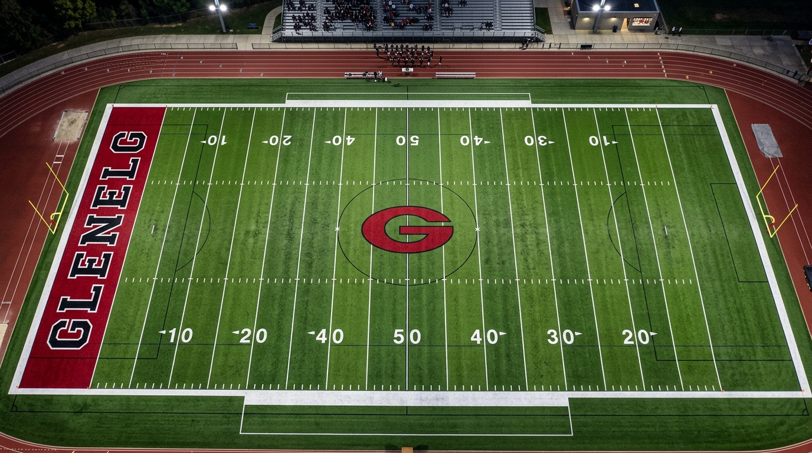

# TitanGlenelg_Unity

**Titan-Glenelg Native AAA High School Football Simulation (Vertical Slice)**  
Targeting **Unity 6 (6000.x LTS)**, **High Definition Render Pipeline (HDRP)**, **DOTS Havok Physics**, and **Burst Compiler**.



---

## Overview
This repository delivers the production-ready vertical slice of the **Titan-Glenelg Native AAA Football Simulation**, faithfully capturing the intensity, tactical depth, and physics of high school powerhouse football under official **NFHS (National Federation of State High School Associations)** rules.

---

## Key Systems Implemented

### 1. Hybrid DOTS ECS / Managed Architecture
- **Unmanaged Core (Entities 1.x / Burst / Havok):**
  - **120 Hz 4th-Order Runge-Kutta (RK4) Ballistics:** Continuous aerodynamic simulation of prolate spheroid drag, angle of attack cross-sectional variation, Magnus lift force, and gyroscopic wobble decay. Writes directly to `PhysicsVelocity` and hands off to Havok rigid-body contact solver on impact.
  - **User Passing Trajectory Triad:** Solves initial launch angles, velocities, and flight times for **Lob** (high arc, run-under), **Touch** (intermediate layer, drops over LBs), and **Bullet** (tight flat spiral) with left-stick placement lead.
  - **User Catch Triad:** Interactive choice of **RAC** (+10% burst speed, high knockout risk), **Aggressive** (+0.75m vertical high-point jump), or **Possession** (two-handed chest tuck, 75% knockout suppression, 0 YAC).
  - **22-Man Unmanaged FSM AI:** Spatial cubic Bezier route running (Stem, Cut, Catch Window) and defensive coverage shells (Zone Drop, Man Shadow, Pass Rush, Intercept Pursuit).
  - **Lineman Trench Warfare Kinematic System:** Virtual kinematic lockup, backward pocket integrity drift (0.3–0.8 m/s), and periodic 0.4s leverage checks ($\Delta M$) driving DL swim/bull-rush sheds, OL anchors, and pancake turf physics.
  - **Active Ragdoll Tackle Momentum:** Upright kinematic locomotion blending into active ragdoll impulse and Two-Bone IK upon contact.

### 2. Focused Playbook
- **Offense (3):**
  1. *Pistol Verticals* (Four Verts)
  2. *Pistol Gladiator Counter Trey* (Pulling LG kickout block & RT seal)
  3. *Pistol Quick Slants* (3-step rhythm pass)
- **Defense (3):**
  1. *Cover 3 Sky* (Single-high 3-deep zone, SS flat roll)
  2. *Cover 2 Man* (Two-high split halves, 5 underneath press-man trail)
  3. *Cover 0 Blitz* (6-man pass rush, zero deep safety help)

### 3. NFHS Officiating & Two-Way Biomechanical Fatigue
- **NFHS Rules Engine:**
  - 12-minute quarters (720 seconds).
  - Clock stoppages on first downs until ball ready for play.
  - 15-yard Defensive Pass Interference (DPI) cap (NFHS Rule 7-5-10).
  - 25s / 40s Play clock with Delay of Game.
  - Kansas Plan untimed overtime from the 10-yard line.
- **Two-Way Ironman Fatigue & Substitutions:**
  - Biomechanical fatigue accumulation for athletes playing both Offense and Defense (1.65x drain multiplier).
  - Continuous penalties: sprint speed (down to -20%), throw velocity (down to -15%), block shed leverage (down to -35%).
  - Non-linear injury hazard escalation below 40% stamina.
  - Tactical depth chart substitution window in the huddle HUD.

---

## Project Structure
```
TitanGlenelg_Unity/
├── Packages/
│   └── manifest.json                    # Unity 6 package manifest (DOTS, Havok, HDRP, Burst)
├── ProjectSettings/
│   └── ProjectVersion.txt               # 6000.0.32f1 LTS
├── Assets/
│   ├── Scripts/
│   │   ├── TitanGlenelg.Core.asmdef     # Assembly definition for Core simulation
│   │   ├── Components/                  # IComponentData structs (Ballistics, FSM, Trench, Simulation)
│   │   ├── Physics/                     # RK4 Ballistics, Trajectory Calculator, Catch Resolution
│   │   ├── AI/                          # Route System, Defensive Coverage, Trench Warfare, Ragdoll Tackle
│   │   ├── Playbook/                    # Playbook Data, Offensive Playbook, Defensive Playbook
│   │   ├── Simulation/                  # NFHSRulesAndClockEngine, TwoWayFatigueSystem, GameCoordinator
│   │   └── Presentation/                # FieldDecalSystem, TacticalHUDController
│   ├── Tests/
│   │   ├── TitanGlenelg.Tests.asmdef    # NUnit Test Runner assembly definition
│   │   ├── RK4BallisticsTests.cs        # Aerodynamics & Trajectory Triad tests
│   │   ├── NFHSRulesTests.cs            # 12-min quarters, 1st down stops, 15-yd DPI, Kansas OT tests
│   │   ├── TrenchWarfareTests.cs        # 0.4s leverage Delta M tests
│   │   ├── TwoWayFatigueTests.cs        # Biomechanical penalties & substitutions tests
│   │   └── CatchResolutionTests.cs      # User catch triad & knockout tests
│   ├── Shaders/
│   │   ├── TeamMannequinHDRP.shader     # HDRP Stylized Team Uniform shader
│   │   └── FieldLineProjector.shader    # Dynamic Line of Scrimmage / 1st Down decal projector
│   ├── Art/
│   │   └── Textures/                    # Turf field & helmet decal textures
│   └── Scenes/
│       └── TitanGlenelg_Stadium.unity   # Stadium simulation scene
├── Documentation/
│   ├── Architecture.md                  # Complete architectural specification
│   ├── Playbook_Guide.md                # 6-play tactical breakdown
│   └── NFHS_Rules_And_Fatigue.md        # Officiating rules and stamina guide
└── tests/
    └── verify_systems.py                # Standalone deterministic Python verification test suite
```

---

## Verification
Run the automated mathematical verification test harness:
```bash
python3 tests/verify_systems.py
```
Outputs deep assertion checks across all RK4 ballistics, trajectory solvers, NFHS clock transitions, two-way fatigue curves, and leverage formulas.
